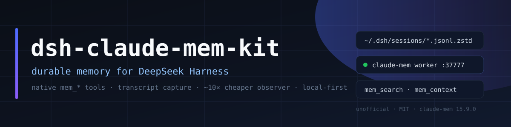

<p align="center"></p>

<p align="center">
  
  
  
  
  
</p>

<h1 align="center">dsh-claude-mem-kit</h1>

<p align="center"><b>Durable cross-session memory for DeepSeek Harness — as a native plugin, at roughly one tenth of the observer cost.</b></p>

> **Unofficial.** This is a community installation and tuning kit for
> [Claude-Mem](https://github.com/thedotmack/claude-mem) running inside
> [DeepSeek Harness](https://github.com/deepseek-ai). It is not affiliated with,
> sponsored by, or endorsed by the Claude-Mem project, DeepSeek, or the authors of
> the DSH adapter it installs.

---

## Why this exists

Claude-Mem 15.9 ships a first-party DeepSeek Harness adapter (`@claude-mem/dsh`)
that registers `mem_search`, `mem_timeline`, `mem_get_observations`, `mem_save`
and `mem_context` as native DSH tools, and captures DSH session transcripts with
a worker. Out of the box, though, it is tuned for a different harness: every tool
call becomes its own observer request, subagent transcripts are captured too, and
the observer conversation grows until it costs tens of thousands of input tokens
per call.

Measured on real DSH sessions, the default setup spends **≈10 900 input tokens
per captured tool event**, and **78 % of all stored observations came from
subagent sessions** that the parent session already summarises. This kit keeps the
memory and removes the waste: **≈5 700 tokens per event and top-level sessions
only**, which lands at roughly **10 % of the original observer spend**.

## What you get

| Piece | What it does |
|---|---|
| `@claude-mem/dsh` bundle wiring | Installs the adapter into a DSH profile, including the Electron-only `desktop` profile that the `dsh plugin` CLI refuses to touch |
| Transcript capture config | Worker tails `~/.dsh/sessions/**/session-*/session.v4.jsonl.zstd` with the DSH schema; subagent sessions are skipped |
| Loopback observer bridge | Small OpenAI-compatible proxy on `127.0.0.1:37901` that adds the `x-opencode-session` header OpenCode Go requires |
| Cost profile | Batch=4, 40 000-char observer generations, 41 skipped DSH meta-tools, shorter startup context, no My Work LLM wording |
| Scripts | Idempotent install / tuning / uninstall for Windows PowerShell |

## How it works

```text
  DSH session
      │  writes
      ▼
  ~/.dsh/sessions/**/session-*/session.v4.jsonl.zstd
      │  transcript-watch.json (schema: dsh)
      ▼
  claude-mem worker  :37777  ──▶  SQLite + Chroma (local)
      │  observer requests (batched)
      ▼
  loopback bridge    :37901  ──▶  OpenCode Go / any OpenAI-compatible endpoint
      │
      ▼
  DSH plugin: context on agent/created + mem_* tools
```

- **Capture** is worker-side; the plugin does not double-write (`ingest` and
  `summarize` stay off in the bundle config).
- **Recall** is pull-based (`mem_search` → `mem_timeline` → `mem_get_observations`)
  plus a compact context block injected when an agent is created.
- **Nothing leaves the machine** except observer requests to the endpoint you
  configure. The worker binds to `127.0.0.1` and has no authentication.

## Requirements

- Windows 10/11 with **DeepSeek Harness Desktop 0.2.1-rc.5+** (`desktop` profile)
- **Node.js 20+**, **pnpm 11+**, **Bun 1.1+** on `PATH`
- Claude-Mem **15.9.0** (the installer fetches it if missing)
- An observer endpoint: **OpenCode Go** (default, via the bundled bridge) or any
  OpenAI-compatible `/chat/completions` API

## Quick start

### A. Desktop profile (recommended)

```powershell
git clone https://github.com/GreenJenckens/dsh-claude-mem-kit.git
cd dsh-claude-mem-kit
powershell -ExecutionPolicy Bypass -File scripts\install.ps1
```

The script:

1. bootstraps Claude-Mem's worker and marketplace into
   `~/.claude/plugins/marketplaces/thedotmack` if they are missing
   (using a throwaway DSH profile that it deletes afterwards);
2. links `@claude-mem/dsh` into `~/.dsh/profiles/desktop` and appends it to
   `dsh.profile.bundles`;
3. writes `~/.claude-mem/transcript-watch.json` with the DSH schema and the
   top-level-only watch;
4. merges the cost profile into `~/.claude-mem/settings.json` (backup kept);
5. starts the worker and the observer bridge, and installs the bridge's
   autostart shortcut.

Then **restart DeepSeek Harness** once. New sessions show the `mem-search` skill
and the `mem_*` tools.

### B. Any other profile (web / tui)

```powershell
npx claude-mem@15.9.0 install --ide dsh --dsh-profile web --no-auto-start
powershell -ExecutionPolicy Bypass -File scripts\apply-tuning.ps1
$w = "$env:USERPROFILE\.claude\plugins\marketplaces\thedotmack\plugin\scripts\worker-service.cjs"
bun $w restart
```

`apply-tuning.ps1` only edits Claude-Mem settings and the transcript watch; it
does not touch DSH profiles.

## Cost tuning

| Knob | Default | This kit | Why |
|---|---|---|---|
| `CLAUDE_MEM_PROVIDER` | `claude` | `openai-compatible` | only this observer class implements observation batching |
| `…OPENAI_COMPAT_OBSERVATION_BATCH_SIZE` | `1` | `4` | up to four tool events per observer request |
| `…OBSERVER_MAX_CONVERSATION_CHARS` | `400000` | `40000` | shorter generations: the re-sent prefix stays small |
| `…OBSERVER_MAX_OUTPUT_TOKENS` | `4096` | `3000` | enough for a batched reply; lower values truncate observations |
| `…SKIP_TOOLS` | 5 tools | 41 tools | DSH meta-tools (`todo_write`, `job_*`, `team_task_*`, `terminal_*`, `computer`, …) carry no durable knowledge |
| transcript watch | all sessions | top-level only (`session-*`) | 78 % of historical observations came from subagent churn |
| `…CONTEXT_OBSERVATIONS` / `…_SESSION_COUNT` | `50` / `10` | `15` / `3` | smaller startup context |
| `…WORK_VIEW_COPY_PROVIDER` | `openrouter` | `off` | My Work wording is presentation-only |
| `…TIER_ROUTING_ENABLED` | `true` | `false` | no accidental expensive model routing |

Measured from the worker log before/after: **≈10 900 → ≈5 700 input tokens per
event**, with 78 % fewer events to process. See [docs/cost-tuning.md](docs/cost-tuning.md)
for the method and for the knobs to go further.

## Verify

```powershell
curl.exe -s http://127.0.0.1:37777/api/health   # worker + provider
curl.exe -s http://127.0.0.1:37901/health       # observer bridge
```

In DSH, ask the agent to call `mem_context` — it should return recent sessions and
observations for the project. Worker logs live in
`~/.claude-mem/logs/claude-mem-<date>.log`.

## Uninstall

```powershell
powershell -ExecutionPolicy Bypass -File scripts\uninstall.ps1            # removes wiring + tuning, keeps the database
powershell -ExecutionPolicy Bypass -File scripts\uninstall.ps1 -PurgeData # also moves ~/.claude-mem to a backup folder
```

## Security notes

- The worker listens on loopback **without authentication**. Do not set
  `CLAUDE_MEM_WORKER_HOST` to a LAN address.
- Your observer API key lives in `~/.claude-mem/settings.json`; never commit that
  file. This repository only ships `config/settings.example.json` with
  placeholders.
- The memory database contains your session content. Treat `~/.claude-mem` as
  sensitive data; auto-redaction is enabled for recognised secret patterns.
- Do not copy `claude-mem.db` while the worker is running (SQLite WAL). Stop the
  worker first, then copy, then start it again.

## License and third-party notices

- **This kit** (scripts, proxy, docs, configs): MIT — see [LICENSE](LICENSE).
- **Claude-Mem** is Apache-2.0, © 2026 Alex Newman. The DSH adapter it installs is
  derived from [Bleed00/dsh-claude-mem](https://github.com/Bleed00/dsh-claude-mem)
  (Apache-2.0). No Claude-Mem source is vendored here: the transcript schema is
  copied at install time from the installed `@claude-mem/dsh` package.
- See [NOTICE](NOTICE) and [third_party/](third_party/README.md). Claude-Mem,
  DeepSeek and DeepSeek Harness are trademarks of their respective owners; this
  project is unofficial and not endorsed by them.

## Repository layout

```text
config/     example settings and transcript watch
docs/       architecture, cost tuning, troubleshooting, banner
proxy/      loopback OpenAI-compatible bridge (OpenCode Go)
scripts/    install / tuning / uninstall (PowerShell + Node helpers)
third_party/ notices for the upstream projects this kit installs
```

---

Русская версия: [README.ru.md](README.ru.md).
