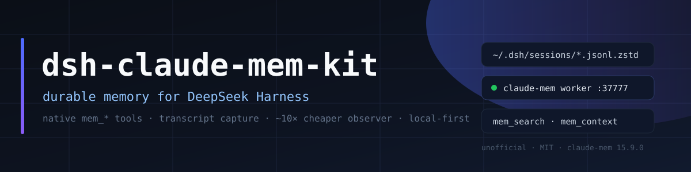

<p align="center"></p>

# dsh-claude-mem-kit

**Долговременная память для DeepSeek Harness — нативно и примерно в 10 раз дешевле по расходу наблюдателя.**

> **Неофициально.** Это набор для установки и настройки
> [Claude-Mem](https://github.com/thedotmack/claude-mem) в
> DeepSeek Harness. Проект не связан с авторами Claude-Mem и DeepSeek и не
> одобрен ими.

## Что делает

Ставит в профиль DSH нативный бандл `@claude-mem/dsh` (инструменты
`mem_search`, `mem_timeline`, `mem_get_observations`, `mem_save`, `mem_context`
плюс скил `mem-search`), настраивает захват транскриптов сессий и снижает расход
модели-наблюдателя.

Работает и с профилем `desktop`, который CLI `dsh plugin` менять отказывается
(«managed exclusively by the Electron application») — скрипт правит профиль
напрямую.

## Почему дешевле

| Рычаг | Было | Стало |
|---|---|---|
| Батчинг событий | 1 событие = 1 запрос | до 4 событий на запрос |
| Поколение диалога наблюдателя | 400 000 символов | 40 000 |
| Захват | все сессии | только верхнеуровневые (`session-*`) |
| Пропуск инструментов | 5 | 41 (мета-рутина DSH) |
| Стартовый контекст | 50 наблюдений / 10 сессий | 15 / 3 |

Замер по логу: **≈10 900 → ≈5 700 входных токенов на событие**, плюс
отбрасывается 78% событий субагентов (их итог и так есть в отчёте родителя).
Итого ≈10% прежнего расхода.

## Установка (Windows)

```powershell
git clone https://github.com/GreenJenckens/dsh-claude-mem-kit.git
cd dsh-claude-mem-kit
pwsh -File scripts/install.ps1
```

Скрипт:

1. ставит воркер и marketplace Claude-Mem, если их нет (через временный профиль);
2. подключает `@claude-mem/dsh` в `~/.dsh/profiles/desktop`;
3. пишет `~/.claude-mem/transcript-watch.json` со схемой DSH;
4. применяет настройки стоимости в `~/.claude-mem/settings.json` (с бэкапом);
5. запускает воркер и мост наблюдателя, добавляет мост в автозагрузку.

После этого **перезапустите DeepSeek Harness** — в новых сессиях появятся
`mem_*` инструменты и скил `mem-search`.

Для других профилей (`web`/`tui`) используйте штатный установщик и
`scripts/apply-tuning.ps1` — подробности в [README.md](README.md).

## Проверка

```powershell
curl.exe -s http://127.0.0.1:37777/api/health
curl.exe -s http://127.0.0.1:37901/health
```

В DSH вызовите `mem_context` — должен вернуться контекст прошлых сессий.

## Безопасность

- Воркер слушает только localhost и **без аутентификации** — не выставляйте его в сеть.
- Ключ API лежит только в `~/.claude-mem/settings.json`; в репозитории его нет.
- База памяти содержит содержимое ваших сессий — считайте `~/.claude-mem` чувствительными данными.
- Не копируйте `claude-mem.db` при работающем воркере (SQLite WAL).

## Лицензии

- Код этого набора (скрипты, прокси, документация): **MIT** — [LICENSE](LICENSE).
- Claude-Mem: **Apache-2.0**, © 2026 Alex Newman. DSH-адаптер основан на
  [Bleed00/dsh-claude-mem](https://github.com/Bleed00/dsh-claude-mem) (Apache-2.0).
  Исходники Claude-Mem в репозиторий не включены — схема транскрипта копируется
  при установке из пакета `@claude-mem/dsh`.
- Подробности: [NOTICE](NOTICE) и [third_party/](third_party/README.md).
